# Screenshots: DevOps Application Deployment Capstone

Evidence for each stage of the project, in the order it was done.

---

## Part 1: Source Code, Docker and Git

### 1. Clone the application and create the `dev` branch
Cloned `devops-build`, created the `dev` branch with `git switch -c dev`, and confirmed the React `build/index.html` exists.

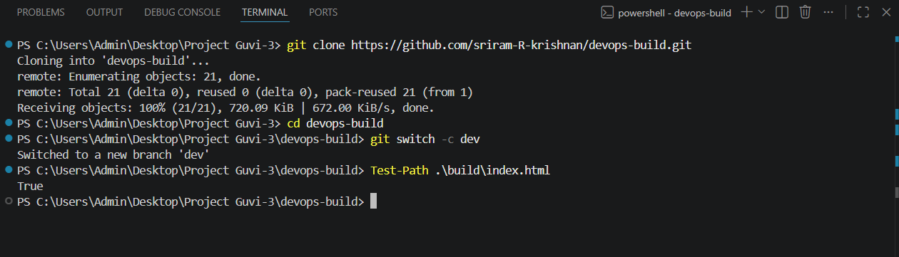

### 2. Create the Docker files
`Dockerfile`, `nginx.conf`, `compose.yaml`, `.dockerignore` and `.gitignore` created in VS Code next to the `build/` folder. `.gitignore` excludes `.env`, `*.pem` and `*.key`.

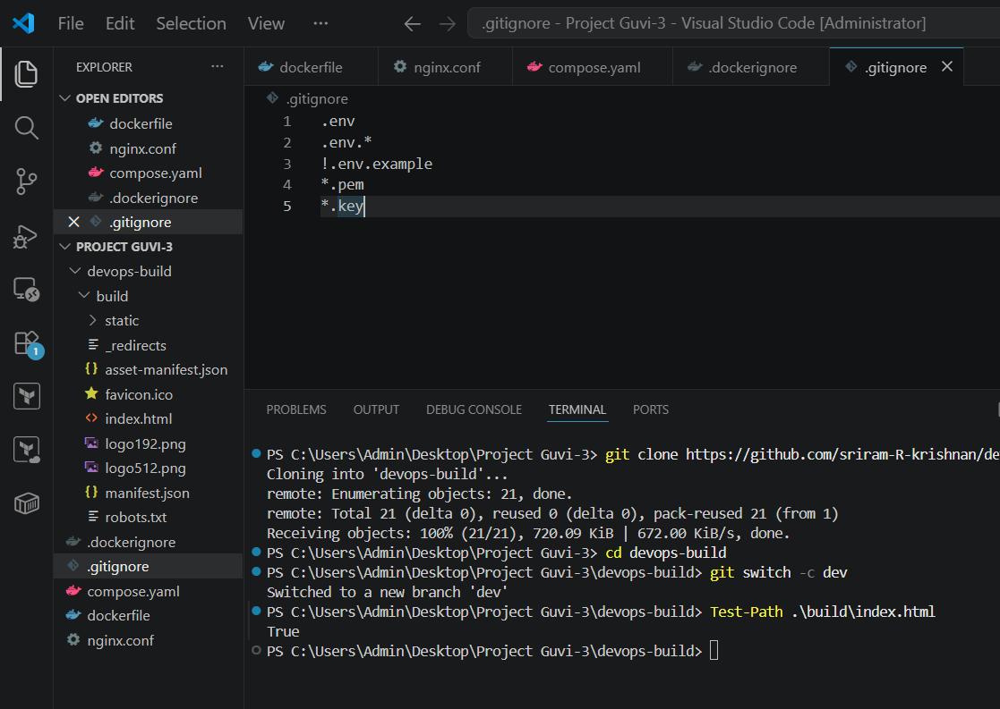

### 3. Run and verify locally with Docker Compose
`docker compose up -d --build` builds the `devops-build:local` image on `nginx:alpine` and starts the container on port 80. `curl http://localhost/healthz` returns `ok`.

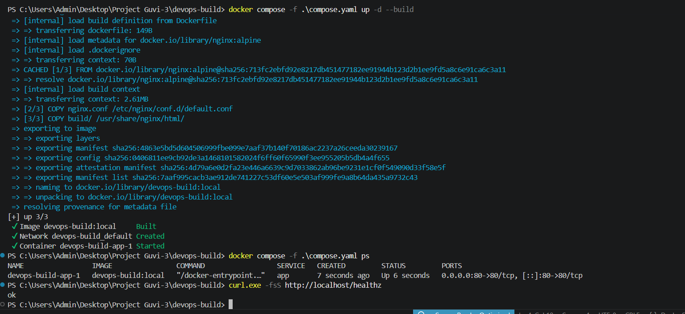

### 4. Commit the containerization work
`.gitattributes` added to keep LF endings on shell scripts, `build.sh` and `deploy.sh` staged as executable (mode 100755), then committed on `dev`: *"Containerize the React app and add build and deploy scripts"* (8 files, 59 insertions).

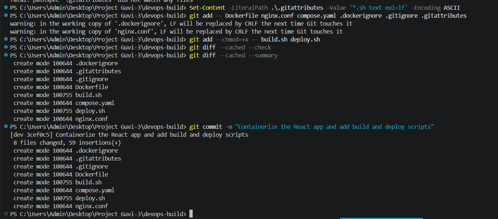

### 5. Push `dev` and `master` to the new GitHub repository
Original remote renamed to `upstream`, new `origin` added, and both branches pushed. `git ls-remote --heads origin` confirms `dev` and `master` exist on GitHub.

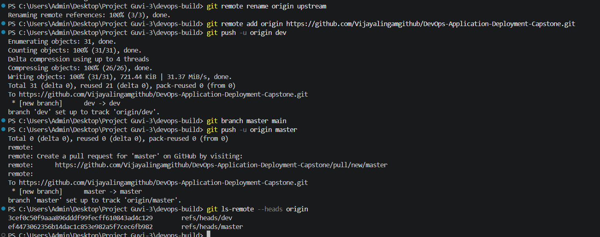

---

## Part 2: Deployment on AWS EC2

### 6. Docker installed and running on EC2
Connected to the Ubuntu 24.04 instance over SSH (MobaXterm), installed Docker, enabled the service. `docker --version` shows 29.1.3 and `is-active` returns `active`.

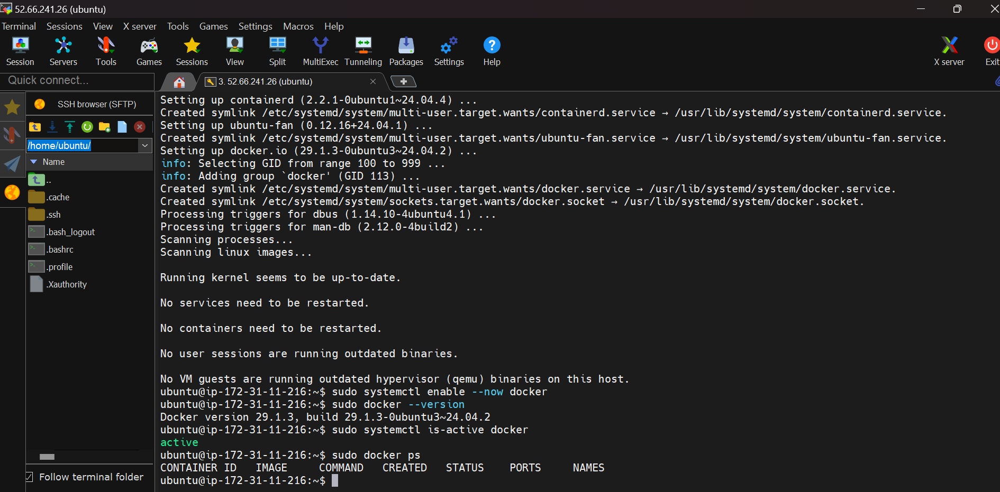

### 7. Docker Hub login and image pull
Logged in to Docker Hub and pulled `dockervijay1998/prod:latest` onto the server.

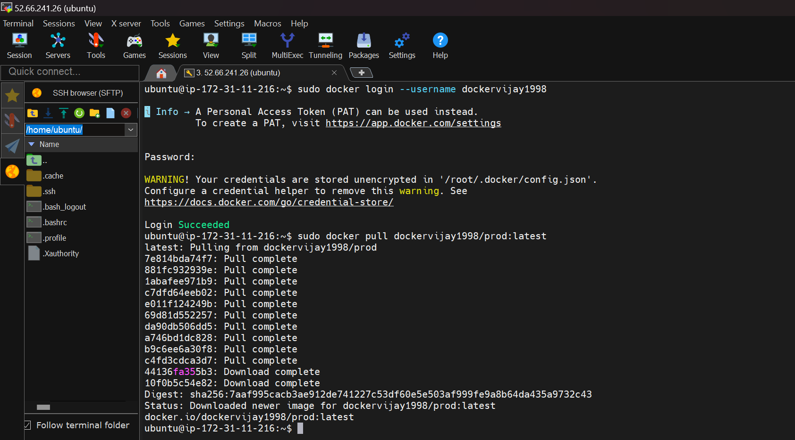

### 8. Image available on the server
`docker images` lists `dockervijay1998/prod:latest` (97.1 MB on disk).

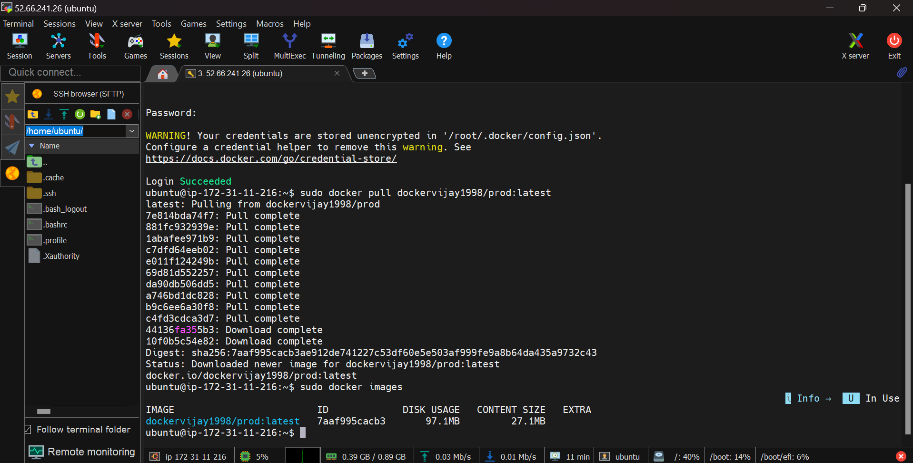

### 9. Application live on EC2
The OnlineShop storefront served from the EC2 public IP in the browser.

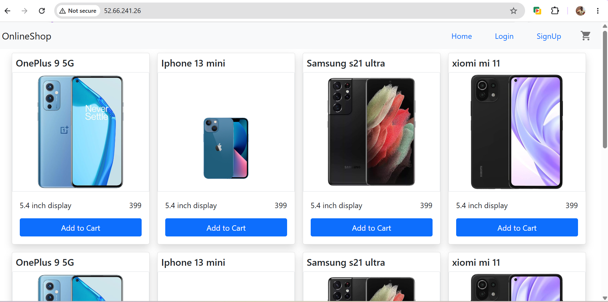

---

## Part 3: CI/CD with Jenkins

### 10. Add the Jenkinsfile and push
`Jenkinsfile` committed to `dev` ("Add Jenkins pipeline", 27 lines) and pushed to GitHub.

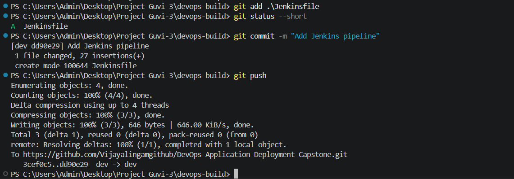

### 11. Jenkins `dev` branch job
`devops-build/dev` shows the last successful build (#7). Build #6 failed earlier and was fixed.

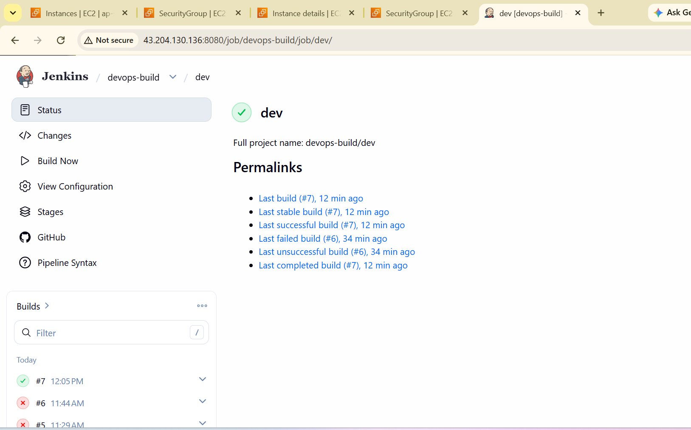

### 12. `dev` build console output
Build #7 runs through `docker image prune -f` and finishes with *"Pipeline succeeded for branch dev"* and **Finished: SUCCESS**.

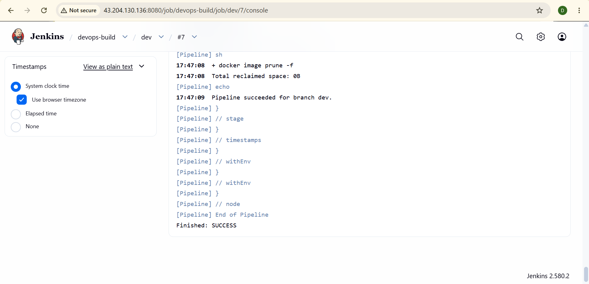

### 13. `master` build console output
Build #7 on `master` ends with *"Pipeline succeeded for branch master"* and **Finished: SUCCESS**.

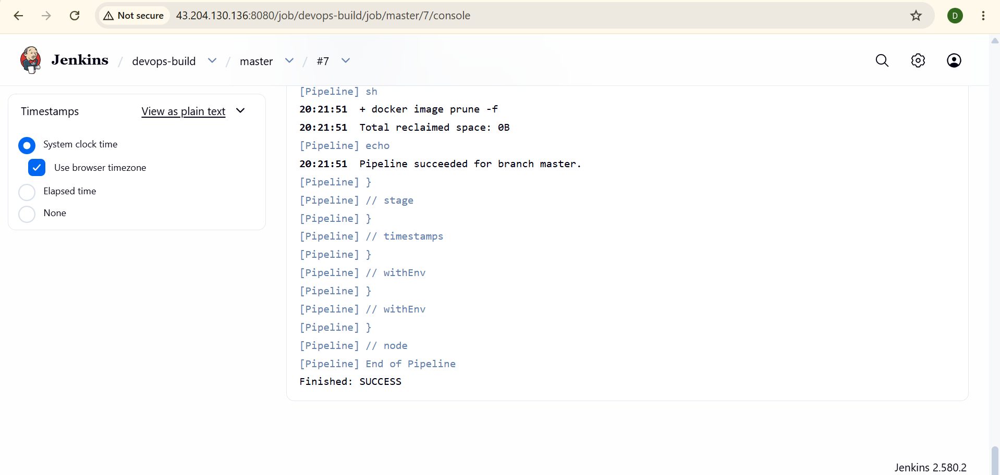

### 14. Multibranch pipeline overview
The `devops-build` multibranch project shows 2 branches (`dev`, `master`), both green.

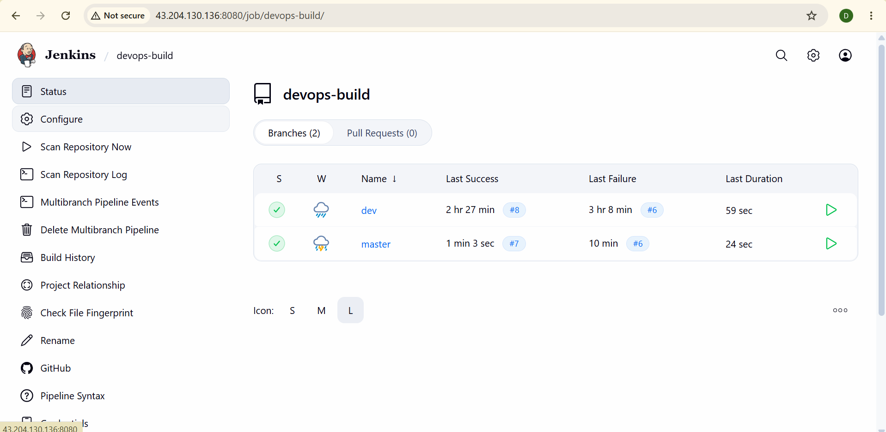

---

## Part 4: Monitoring with Prometheus

### 15. Prometheus UI
Prometheus running on port 9090 of the app server.

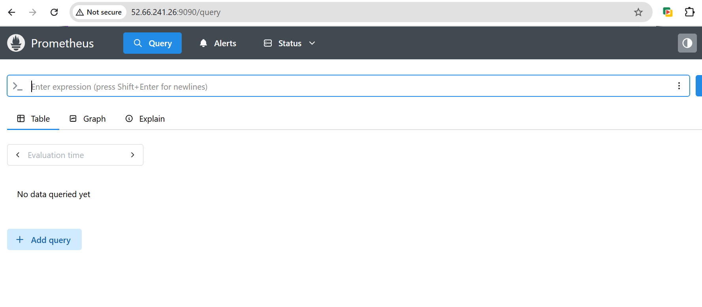

### 16. Prometheus targets: all UP
Status > Target health shows `app-server` (port 9100 metrics) and `prometheus` (localhost:9090) both **UP**.

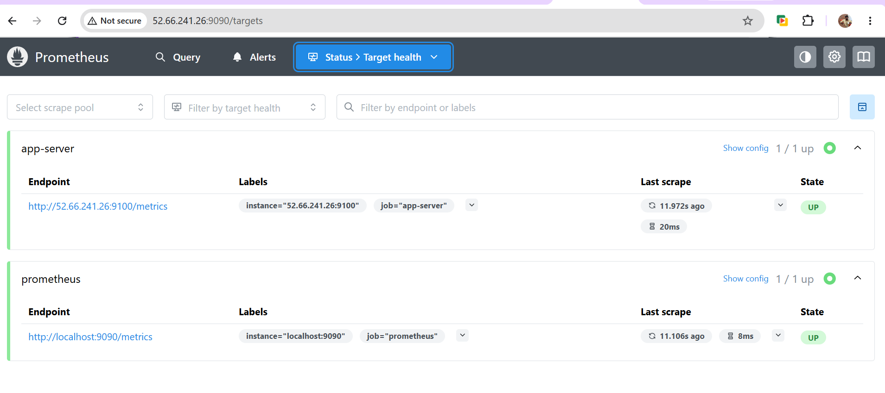
